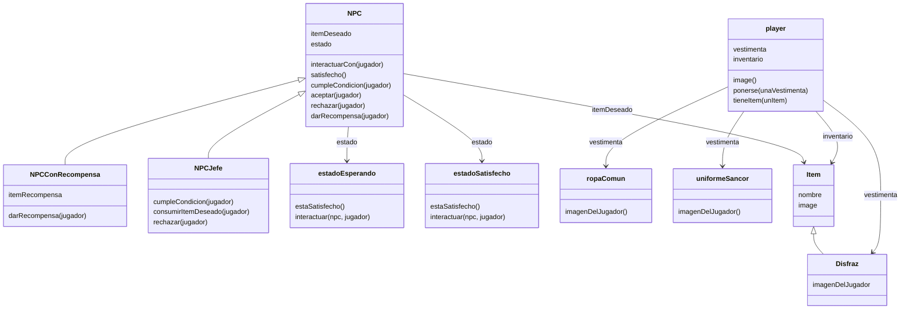

# Explicaciones teóricas

## 1. Polimorfismo: estados de los NPCs

Lo que dice un NPC cuando el jugador se le acerca depende del estado en el que está. En lugar de preguntar con if/else si el NPC ya está satisfecho, cada NPC tiene un `estado` y le delega la interacción:

```wollok
method interactuarCon(jugador) {
    estado.interactuar(self, jugador)
}
```

Hay dos estados, `estadoEsperando` y `estadoSatisfecho`. Los dos entienden los mismos mensajes (`estaSatisfecho()` e `interactuar(npc, jugador)`), así que el NPC puede usar cualquiera de los dos sin saber cuál es:

- `estadoEsperando`: si el jugador cumple la condición, el NPC lo acepta (agradece y queda satisfecho). Si no, lo rechaza.
- `estadoSatisfecho`: el NPC dice que ya tiene lo que necesita.

Para agregar un estado nuevo (por ejemplo, un NPC enojado) alcanza con crear otro objeto que entienda esos mensajes, sin tocar la clase `NPC`.

La `Puerta` también usa polimorfismo: pregunta `npc.satisfecho()` y no le importa qué tipo de NPC es ni en qué estado está.

## 2. Polimorfismo: la vestimenta del jugador

Cómo se ve el jugador no depende del jugador sino de lo que tiene puesto:

```wollok
method image() = vestimenta.imagenDelJugador()
```

`ropaComun`, `uniformeSancor` y cualquier `Disfraz` entienden `imagenDelJugador()`. Si se agrega otro disfraz, no hay que agregar un caso nuevo en el player: alcanza con que la nueva vestimenta sepa qué imagen mostrar.

## 3. Herencia y redefinición de métodos

`NPC` define el comportamiento general: qué condición pide (`cumpleCondicion`), qué hace al aceptar (`aceptar`) y qué hace al rechazar (`rechazar`). Las subclases solo redefinen lo que cambia:

- `NPCConRecompensa` redefine `darRecompensa` para dejar un ítem en la habitación (De Paul deja la llave del armario).
- `NPCJefe` (el Chiqui Tapia) redefine `cumpleCondicion`: no pide un ítem del inventario sino que el jugador lleve puesto el `uniformeSancor`. También redefine `consumirItemDeseado` para no sacarle nada al jugador, y `rechazar`, que usa `super(jugador)` para decir su mensaje y además termina el juego.

## Ítems como objetos

Lo que pide cada NPC, la impresora y el armario son los objetos ítem (`mate`, `fotoDeMessi`, `llaveArmario`, `papel`, `tinta`), no sus nombres como string. Así el player responde `tieneItem(unItem)` con `inventario.contains(unItem)` y no compara textos. El `nombre` de los ítems se usa solo para armar los mensajes que se muestran en pantalla.

# Diagramas


